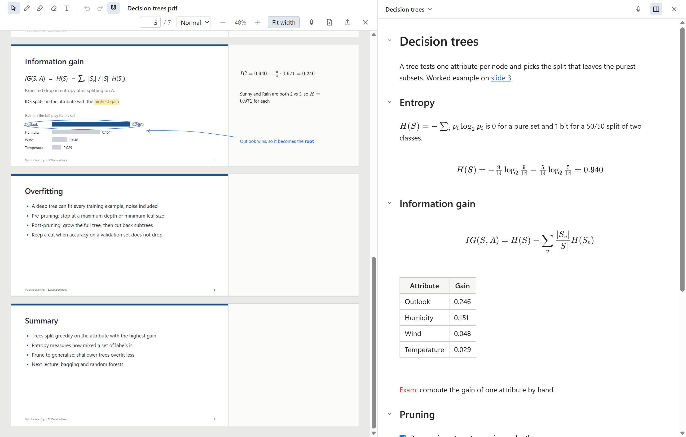
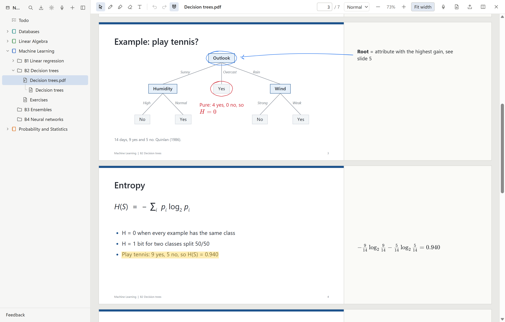
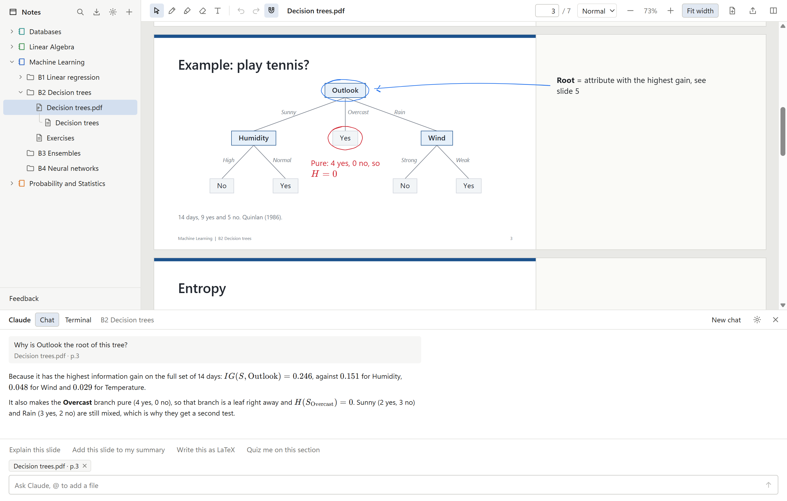

# Marginalia

A Windows desktop app for lecture notes. Import the slide PDF, write on it, and keep a Markdown summary with LaTeX next to it. Everything is stored as plain files in a folder you choose.

<picture>
  <source media="(prefers-color-scheme: dark)" srcset="docs/screenshots/lecture-dark.png">
  
</picture>

I built it for my own courses at KU Leuven, to replace a mix of OneNote (for scribbling on slides), Obsidian (for summaries) and a separate chat window for asking Claude about the slides.

Claude is built in two ways:

- **A chat panel** for questions. It already has the context: the slide you are on, your annotations and the notes around your cursor, so you can just ask "what does this formula mean?".
- **`/claude` inside your notes.** While taking notes, type `/claude` and a request in your summary or in a text box on a slide. Claude edits or adds to the text right there, and you keep writing.

## Features

<picture>
  <source media="(prefers-color-scheme: dark)" srcset="docs/screenshots/slides-dark.png">
  
</picture>

**Organise**
- Open any folder as a vault. Top-level folders are courses, subfolders are lectures, nested as deep as you like.
- Create, rename, move and delete from the sidebar. Deletes go to the Recycle Bin.
- Natural sort order (B2 before B10). An optional `_order.json` in a folder sets your own order.

**Slides**
- Import PDFs by drag and drop or Ctrl+Shift+I. The original is copied, never moved.
- Pen, highlighter, eraser and text boxes, on the slide or in a margin next to it.
- Highlight selected slide text with H.
- Paste or drop images onto a slide. Text boxes and images snap to slide text and edges.
- Add blank pages below any slide for extra working space.
- Export a PDF with all annotations burned in.

**Summary**
- Markdown editor with live preview: headings, tables, images and KaTeX math render in place and turn back into source where your cursor is.
- Slash menu for headings, lists, tables, math blocks, text colour and slide links.
- Ctrl+Shift+L inserts a link to the current slide, Ctrl+Shift+S pastes a snapshot of part of it.
- Files stay standard Markdown, so they open the same in Obsidian or VS Code.

**Lecture mode**
- Ctrl+Shift+M puts the slides on the left and their summary on the right, and hides the sidebar.

**Search**
- Ctrl+P to jump to any file, Ctrl+Shift+F to search the text of every note and slide.

## Claude in the app

Claude is built into the places you already work, and it always knows where you are. With every message it gets the open file, the slide on screen (its text and an image of it), your annotations on that slide, any text you selected and the part of your summary around your cursor. You don't have to copy anything over or explain which slide you mean.

<picture>
  <source media="(prefers-color-scheme: dark)" srcset="docs/screenshots/claude-dark.png">
  
</picture>

**Ask questions in the chat panel (Ctrl+L)**
- "Explain the formula on this slide" or "Why is entropy maximal here?" works without any setup.
- Type `@` to add other notes or PDFs from your vault as context.
- One conversation per lecture, kept when you close the app.

**Let it edit your notes**
- Ask "add a short version of this under Information gain" and it writes into your summary, under that heading.
- It can put a text box in the margin next to a slide or highlight a phrase on it.
- With "ask before editing" on (the default), you see each change first and accept or reject it. Every edit is one undo step.

**Write in place with `/claude`**
- Type `/claude <request>` at the end of a line in a summary or in a text box on a slide, and press Enter.
- The answer replaces the request right there, using the slide and the text around it. For example `/claude derive this step` under a formula, or `/claude fix the LaTeX in this paragraph`.
- You can keep typing while it works, run several at once, and cancel with Esc.

**Skills**
- Type `/` in the chat for longer jobs on the lecture you have open:
  - `/summary` writes a summary note from the slides, the transcript, your notes and your annotations, linked to the PDF.
  - `/cleanup` tidies your annotations (typos, LaTeX, layout) without dropping anything you wrote, and adds a **Check:** line where something looks wrong.
  - `/exercise` turns an exercise session (the chat, your notes and annotations) into a note with the solutions, key takeaways, exam tips and what to redo.
- Text after the command is passed on, for example `/summary only the part on pruning`.

**Terminal tab**
- Runs Claude Code inside your vault folder, for bigger jobs like reorganising a course or writing a summary from several lectures.

Claude can only read files inside your vault. The chat panel cannot run commands: it changes files only through the app (new notes, edits to notes and annotations), and with "ask before editing" on you approve each change.

## How your files look on disk

```
Machine Learning/                       course
  B2 Decision trees/                    lecture
    slides.pdf
    slides.pdf.annotations.json         your annotations (JSON)
    slides.md                           your summary
    assets/                             pasted images and snapshots
.marginalia/                            app settings for this vault
```

Annotations live in a JSON file next to each PDF. The PDF itself is never changed. Renaming or moving a PDF in the app takes its annotations and summary along.

Writes are atomic (temp file, then rename), so a crash or power cut does not leave half-written files.

## Install

Windows 11 only. You build the installer yourself from this repository; one command does it.

1. Install [Git](https://git-scm.com/download/win) and [Node.js](https://nodejs.org) 22 or later. In PowerShell: `winget install Git.Git OpenJS.NodeJS.LTS`, then open a new terminal.
2. Clone and install:

   ```sh
   git clone https://github.com/maboke123/marginalia-poc.git marginalia
   cd marginalia
   npm ci
   npm run deploy
   ```

`npm run deploy` checks the code, builds the installer, starts the built app once off screen to see that it works, then installs Marginalia for your Windows user (no admin rights needed) and starts it. The first run downloads speech to text (about 200 MB) and takes a few minutes. Afterwards the app is in the Start menu.

To update later, in the same folder:

```sh
git pull
npm ci
npm run deploy
```

Deploying closes a running Marginalia first (it saves everything) and keeps your settings. Your notes are not touched: they live in the vault folder you pick, not in the app.

Optional: to transcribe video or audio files you drop in, install ffmpeg with `winget install Gyan.FFmpeg`. Recording in the app works without it.

### Setting up Claude

Claude uses the Claude Agent SDK and needs one of these:

- A Claude Code login on the same machine (a Pro or Max plan). Run `claude` once in the terminal tab and log in.
- An Anthropic API key, entered in Settings. This is billed per use.

Everything except Claude works offline.

## Build from source

Requires Node.js 22 or later and npm.

```sh
npm ci
npm run dev          # run with hot reload
npm run build:win    # only build the installer into dist/
npm run deploy       # build, check and install it (see Install)
```

If Electron starts as plain Node (for example inside the VS Code terminal), unset `ELECTRON_RUN_AS_NODE` first.

### Tests

```sh
npm test             # unit tests (Vitest)
npm run test:e2e     # end-to-end tests that drive the built app (Playwright)
npm run typecheck
npm run lint
npm run screenshots  # rebuild the README screenshots from a demo vault
```

End-to-end tests run against temporary vaults and a scripted fake of Claude, so they never touch your own notes or use your Claude plan.

## Built with

Electron, React, TypeScript, pdf.js, pdf-lib, CodeMirror 6, KaTeX, perfect-freehand, xterm.js and the Claude Agent SDK.

## Hotkeys

| Action | Default |
| --- | --- |
| Lecture mode | Ctrl+Shift+M |
| Claude panel | Ctrl+L |
| Import PDF | Ctrl+Shift+I |
| Insert link to current slide | Ctrl+Shift+L |
| Slide snapshot | Ctrl+Shift+S |
| Quick switcher | Ctrl+P |
| Search everything | Ctrl+Shift+F |
| Settings | Ctrl+, |
| Select, pen, highlighter, eraser, text box | V, P, H, E, T |

All of them can be changed in Settings.
