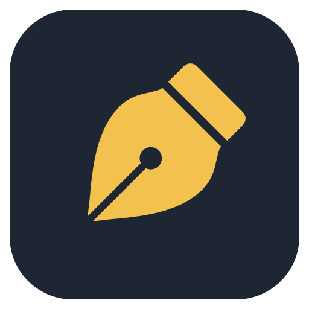
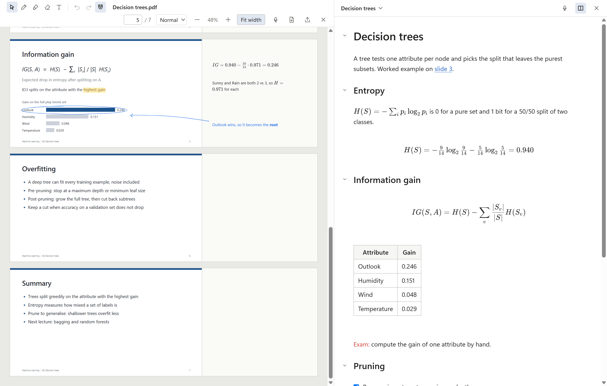
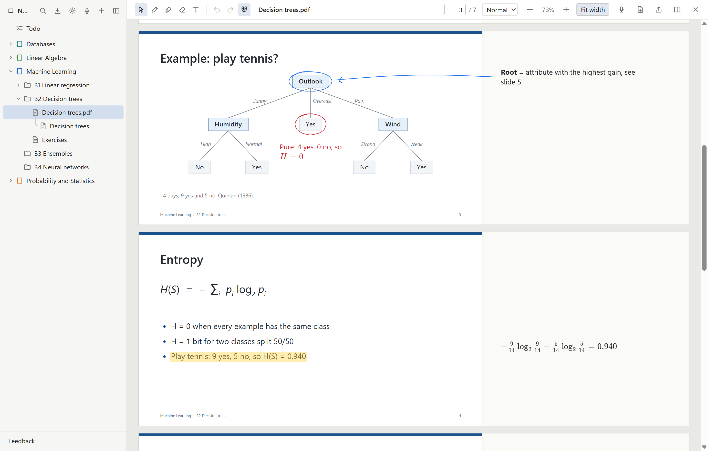
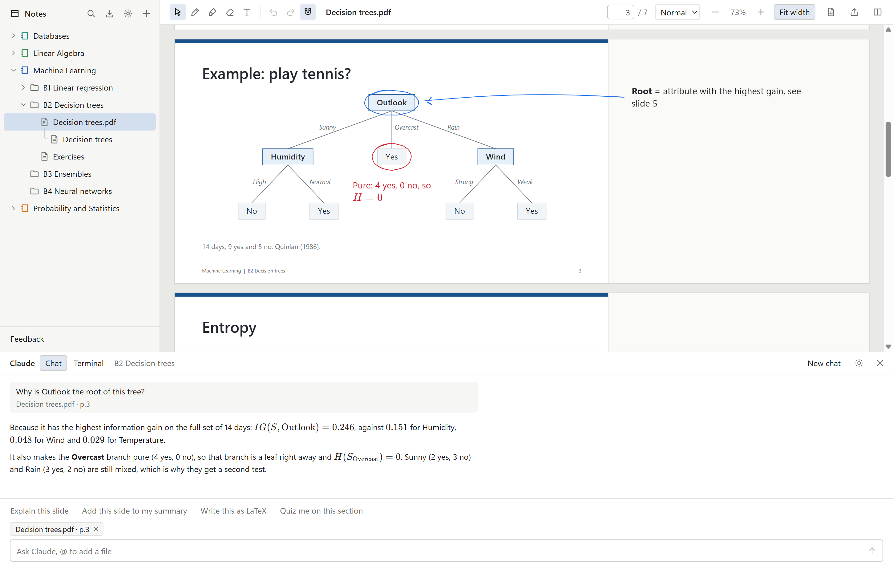

# Marginalia

A Windows desktop app for lecture notes. Import the slide PDF, write on it, keep Markdown notes with LaTeX next to it, and record the lecture. Everything is stored as plain files in a folder you choose.

<picture>
  <source media="(prefers-color-scheme: dark)" srcset="docs/screenshots/lecture-dark.png">
  
</picture>

I built it for my own courses at KU Leuven, to replace a mix of OneNote (for scribbling on slides), Obsidian (for summaries), a voice recorder and a separate chat window for asking Claude about the slides.

Claude is built in two ways:

- **A chat panel** for questions. It already has the context: the slide you are on, your annotations, the notes around your cursor and the lecture transcript, so you can just ask "what does this formula mean?".
- **`/claude` inside your notes.** Type `/claude` and a request in a note or in a text box on a slide. Claude writes the answer right there, and you keep writing.

## Features

<picture>
  <source media="(prefers-color-scheme: dark)" srcset="docs/screenshots/slides-dark.png">
  
</picture>

**Organise**

- Open any folder as a vault. Top-level folders are courses, subfolders are lectures, nested as deep as you like.
- Create, rename, move and delete from the sidebar. Deletes go to the Recycle Bin.
- Right-click slides for a new note or canvas that is linked to them.
- Export a whole folder as PDFs (slides with their annotations, notes and canvases, subfolders kept) into a new folder or one zip.
- Give any folder a colour (red, orange, yellow, green, dark green, blue, ...), for example to track which lectures you have reviewed.
- Hide folders and files you do not want to see, like a code repository for an assignment. Settings lists them to bring them back.
- A Todo note pinned above all courses, for things that do not belong to one lecture.
- Natural sort order (B2 before B10). An optional `_order.json` in a folder sets your own order.

**Slides**

- Import PDFs by drag and drop or Ctrl+Shift+I. The original is copied, never moved.
- Pen, highlighter, eraser and text boxes, on the slide or in a margin next to it.
- Highlight selected slide text with H. Colour or resize part of the text in a text box.
- Paste or drop images onto a slide. Text boxes and images snap to slide text and edges, and can be dragged onto another slide.
- Add blank pages below any slide for extra working space.
- Ctrl+F finds text on the slides and in your text boxes.
- Export a PDF with all annotations burned in.

**Notes**

- Markdown editor with live preview: headings, tables, images and KaTeX math render in place and turn back into source where your cursor is.
- Slash menu for headings, lists, tables, math blocks, text colour and slide links. It puts the heading level you most likely want next first.
- Fold a section under its heading. Folds are remembered per note.
- `mermaid` and `vega-lite` code blocks are drawn as charts.
- Ctrl+Shift+L inserts a link to the current slide, Ctrl+Shift+S pastes a snapshot of part of it (into a canvas too).
- Preview a note or canvas as a PDF before exporting it.
- Zoom with Ctrl+wheel or a touchpad pinch.
- Files stay standard Markdown, so they open the same in Obsidian or VS Code.

**Canvas**

- A page you can zoom and pan without end, for diagrams, mind maps and overviews. Text boxes with Markdown and math, images, pen drawings, groups and arrows between boxes.
- UML shapes and relations: classes with compartments, interfaces, actors, use cases, states, decisions, and arrows for inheritance, realization, composition, aggregation and dependency, with multiplicities.
- Sequence diagrams: lifelines, activation bars and fragments (loop, alt, opt), with message and reply arrows. Drag an arrow from a bar onto another lifeline and the bar for that call appears at the same height. A lifeline takes its bars along when you move it.
- Add images from your computer, paste a screenshot, or select a drawing to resize it, strokes and all. Tab indents inside a box.
- Boxes snap to the edges and middles of other boxes, to equal spacing, and evenly around a box above (two subclasses under their superclass). Hold Alt to place freely.
- Arrows are curved or go around boxes at right angles. Drag the middle of a right-angle arrow to route it yourself.
- Larger and smaller text (Ctrl+Shift+> and <) grows the box with it, so the text wraps as before.
- Saved as `.canvas` files in the JSON Canvas format, so they open in Obsidian too. Export a canvas as a one-page PDF.

**Lecture mode and side by side**

- Ctrl+Shift+M puts the slides on the left and their note on the right, and hides the sidebar.
- A PDF can have several notes (your summary, a derivation, the transcript). The title of the note pane switches between them and remembers your pick.
- Open two, three or four files side by side (Ctrl+Alt+G, or drag a file from the sidebar to the edge of a pane). Drag the borders to resize.

**Recording and transcripts**

- Ctrl+Shift+R records the lecture. The app remembers which slide was on screen when, so the transcript links each part to its slide.
- Record the microphone, or the computer's own sound for a lecture video you watch at home.
- Speech to text runs locally with whisper.cpp; no audio leaves your PC. Transcription starts by itself while the laptop is plugged in, in the language you set per course, and goes on where it stopped after a restart.
- Drop a video or audio file of a lecture to transcribe it. For a video, the app matches the frames to the slides.
- Import a transcript someone else recorded, or the captions a lecturer posts (.vtt, .srt, .txt). Each paragraph is linked to the slide it talks about, matched by its words.
- A recording with no sound at all (a muted microphone, the wrong source) goes to the Recycle Bin instead of being tried again and again.
- Transcripts stay out of the way: a lecture with recordings shows a small microphone badge in the sidebar. Claude and search still use them.

**Search**

- Ctrl+P to jump to any file, Ctrl+Shift+F to search the text of every note and slide.

## Claude in the app

Claude is built into the places you already work, and it always knows where you are. With every message it gets the open file, the slide on screen (its text and an image of it), your annotations on that slide, any text you selected and the part of your note around your cursor. You don't have to copy anything over or explain which slide you mean.

<picture>
  <source media="(prefers-color-scheme: dark)" srcset="docs/screenshots/claude-dark.png">
  
</picture>

**Ask questions in the chat panel (Ctrl+L)**

- "Explain the formula on this slide" or "Why is entropy maximal here?" works without any setup.
- Type `@` to add other notes or PDFs from your vault as context, a whole folder (a course or a lecture), or the conversation of another lecture.
- Paste, drop or pick images to send along with a question.
- The panel sits under the files or on their right (Settings).
- One conversation per lecture, kept when you close the app. The chat you ask in stays while you open files in its subfolders; the name above the chat switches to the chat of any other folder.
- Select text in an answer to copy it (formulas come out as LaTeX) or to ask about that part.

**Let it edit your notes and slides**

- Ask "add a short version of this under Information gain" and it writes into your note, under that heading.
- On the slides it can add, change, move and remove text boxes, highlight or underline text, draw lines and arrows, and add blank pages.
- On a canvas it reads and draws boxes and arrows, and lays out new diagrams itself.
- It makes folders and renames, moves and links files like the sidebar does; deleting asks you first.
- It can take a screenshot of a page or a canvas as the app draws it, to check that things fit and do not overlap.
- Your view stays where you are reading while it edits; a change to a note that is not open goes straight into the file.
- With "ask before editing" on (the default), you see each change first and accept or reject it. Click a waiting change in the chat to jump to it. "Accept all" lets the rest of that answer through. Every edit is one undo step.

**Write in place with `/claude`**

- Type `/claude <request>` at the end of a line in a note or in a text box on a slide, and press Enter.
- The answer replaces the request right there, using the slide and the text around it. For example `/claude derive this step` under a formula, or `/claude fix the LaTeX in this paragraph`.
- You can keep typing while it works, run several at once, and cancel with Esc.

**Skills**

- Type `/` in the chat for longer jobs on the lecture you have open:
  - `/summary` writes a summary note from the slides, the transcript, your notes and your annotations, linked to the PDF.
  - `/cleanup` tidies your annotations (typos, LaTeX, layout) without dropping anything you wrote, and adds a **Check:** line where something looks wrong.
  - `/uml` models a system you describe (a class diagram by default, or use case, state and activity diagrams) on a canvas. It can learn one course first (Claude settings): it reads the slides, transcripts, notes and your diagrams lesson by lesson into notes and a short playbook, so its diagrams follow how that lecturer models. Learning the whole course the first time takes a lot of usage; after that it takes in new files when you ask, or by itself if you turn that on.
  - `/exercise` turns an exercise session (the chat, your notes and annotations) into a note with the solutions, key takeaways, exam tips and what to redo.
- Text after the command is passed on, for example `/summary only the part on pruning`.

**Your own instructions**

- The Claude settings have a field for standing instructions, added to the chat, `/claude` and the terminal. I use it for what my folder colours mean.
- Add folders outside the vault that the chat may read, like the code of a course project.

**Terminal tab**

- Runs Claude Code inside your vault folder, for bigger jobs like reorganising a course or writing a summary from several lectures.

Claude can only read files inside your vault and the folders you add in its settings. The chat panel cannot run commands: it changes files only through the app (new notes, edits to notes and annotations), and with "ask before editing" on you approve each change.

## How your files look on disk

```
Todo.md                                 notes for all courses
Machine Learning/                       course
  B2 Decision trees/                    lecture
    slides.pdf
    slides.pdf.annotations.json         your annotations (JSON)
    slides.md                           your note
    Class diagram.canvas                a canvas (JSON Canvas)
    Transcript 2026-10-05 11-44.md      a recording's transcript
    assets/                             pasted images, snapshots and recordings
.marginalia/                            settings and state for this vault
```

Annotations live in a JSON file next to each PDF. The PDF itself is never changed. Renaming or moving a PDF in the app takes its annotations and notes along.

Writes are atomic (temp file, then rename), so a crash or power cut does not leave half-written files.

## Install

Windows 11 only. You build the installer yourself from this repository; one command does it.

1. Install [Git](https://git-scm.com/download/win), [Node.js](https://nodejs.org) 22 or later and ffmpeg (for transcribing recordings). In PowerShell: `winget install Git.Git OpenJS.NodeJS.LTS Gyan.FFmpeg`, then open a new terminal.
2. Clone and install:

   ```sh
   git clone https://github.com/maboke123/marginalia-poc.git marginalia
   cd marginalia
   npm ci
   npm run deploy
   ```

`npm run deploy` checks the code, builds the installer, starts the built app once off screen to see that it works, then installs Marginalia for your Windows user (no admin rights needed) and starts it. The first run downloads the speech to text program and model (about 210 MB) and takes a few minutes. Afterwards the app is in the Start menu. The more accurate model for recorded lectures (about 575 MB) downloads the first time it is used.

To update later, in the same folder:

```sh
git pull
npm ci
npm run deploy
```

Deploying closes a running Marginalia first (it saves everything) and keeps your settings. Your notes are not touched: they live in the vault folder you pick, not in the app.

### Setting up Claude

Claude uses the Claude Agent SDK and needs one of these:

- A Claude Code login on the same machine (a Pro or Max plan). Run `claude` once in the terminal tab and log in.
- An Anthropic API key, entered in Settings. This is billed per use.

Everything except Claude works offline.

## Build from source

Requires Node.js 22 or later and npm.

```sh
npm ci
npm run dev          # run with hot reload
npm run build:win    # only build the installer into dist/
npm run deploy       # build, check and install it (see Install)
```

If Electron starts as plain Node (for example inside the VS Code terminal), unset `ELECTRON_RUN_AS_NODE` first.

### Tests

```sh
npm test             # unit tests (Vitest)
npm run test:e2e     # end-to-end tests that drive the built app (Playwright)
npm run typecheck
npm run lint
npm run screenshots  # rebuild the README screenshots from a demo vault
```

End-to-end tests run against temporary vaults, a scripted fake of Claude and a fake microphone, so they never touch your own notes or use your Claude plan.

## Built with

Electron, React, TypeScript, pdf.js, pdf-lib, CodeMirror 6, KaTeX, Mermaid, Vega-Lite, perfect-freehand, whisper.cpp, xterm.js and the Claude Agent SDK.

## Hotkeys

| Action                                     | Default       |
| ------------------------------------------ | ------------- |
| Lecture mode                               | Ctrl+Shift+M  |
| Files side by side (1, 2, 3 or 4)          | Ctrl+Alt+G    |
| Claude panel                               | Ctrl+L        |
| Record the lecture                         | Ctrl+Shift+R  |
| Import PDF                                 | Ctrl+Shift+I  |
| Insert link to current slide               | Ctrl+Shift+L  |
| Slide snapshot                             | Ctrl+Shift+S  |
| Quick switcher                             | Ctrl+P        |
| Search everything                          | Ctrl+Shift+F  |
| Find in the slides                         | Ctrl+F        |
| Todo note                                  | Ctrl+Shift+T  |
| Show or hide the sidebar                   | Ctrl+\        |
| Close the open files                       | Ctrl+W        |
| Full screen                                | F11           |
| Settings                                   | Ctrl+,        |
| Select, pen, highlighter, eraser, text box | V, P, H, E, T |

All of them except Ctrl+F can be changed in Settings.

## License

[PolyForm Noncommercial 1.0.0](LICENSE.md). You may use, change and share Marginalia for personal, study and other noncommercial purposes, and fork it. Selling it or using it commercially is not allowed.
